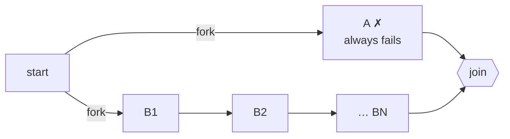

# Work wasted after a failure inside a fork

This measures how much work a fork does after one of its branches has failed, before and after
sibling branches learned to stop early (commit `0244212`). It answers issue #1.

## Scenario



- `start` forks into branch **A**, whose only step always fails, and branch **B**, a chain of N
  steps, each taking 1 s, before the join.
- A step that throws is retried twice, a second apart, so A gives up about 2 s after it first
  ran, while B is still working.
- N = 1, 3 and 5; five runs of each, one after the other, over the real broker and Redis
  (Testcontainers: `apache/kafka:3.7.0`, `redis:7-alpine`).

## What is measured

| Metric | Meaning |
|---|---|
| B steps run | B's steps whose work started at all |
| wasted steps | B's steps whose work started **after A had given up**, when the instance was already bound to be undone |
| wasted undos | the undos those wasted steps caused |
| B steps skipped | B's steps recorded as `SKIPPED` instead of run |
| failure → compensated | from A giving up (its last attempt) to the instance reaching the compensated topic |

## Results

Medians of five runs. Every run of a configuration gave the same step counts; the per-run
numbers are in [`fork-failure-before.csv`](fork-failure-before.csv) and
[`fork-failure-after.csv`](fork-failure-after.csv).

| N | | B steps run | wasted steps | wasted undos | B steps skipped | failure → compensated |
|---|---|---|---|---|---|---|
| 1 | before | 1 | 0 | 0 | 0 | 55 ms |
| 1 | after | 1 | 0 | 0 | 0 | 57 ms |
| 3 | before | 3 | 1 | 1 | 0 | 1094 ms |
| 3 | after | 2 | **0** | **0** | 1 | **79 ms** |
| 5 | before | 5 | 3 | 3 | 0 | 3126 ms |
| 5 | after | 2 | **0** | **0** | 1 | **68 ms** |

## Reading the numbers

- **Before**, every B step that started after A gave up was wasted: N − 2 of them, since about
  two of B's steps fit into A's two seconds of retries. Each was later undone, and the time from
  the failure to `compensated` grew by about a second per wasted step, because the join had to
  wait for B to finish.
- **After**, no step starts after the failure is known. The B step that is about to start when
  A gives up is recorded as skipped and goes straight to the join; the steps after it are never
  reached, which is why "B steps skipped" stays at 1 whatever N is. The time to `compensated`
  no longer depends on N.
- With N = 1, B is finished before A gives up, so there is nothing to save, and both versions
  behave the same.
- What is not saved: a B step already running when A gives up still finishes, and is undone.
  Steps are not interrupted.

## Reproducing

The benchmark is `src/test/java/com/eda/choreography/infra/kafka/ForkFailureBenchmark.java`. Its
name keeps it out of `mvn verify`; it needs Docker.

```bash
mvn verify -Dit.test=ForkFailureBenchmark -Dtest=NoSuchTest -Dsurefire.failIfNoSpecifiedTests=false \
    -Dbenchmark.label=after -Dbenchmark.repetitions=5
```

Optional properties: `benchmark.branchLengths` (default `1,3,5`), `benchmark.repetitions`
(default `3`), `benchmark.stepMillis` (default `1000`). Results are printed and written to
`target/benchmarks/fork-failure-<label>.csv`.

The benchmark only uses what the engine had before fork skipping, so the "before" numbers come
from the same file run on the commit before the change:

```bash
git worktree add ../before 1779b53
cp src/test/java/com/eda/choreography/infra/kafka/ForkFailureBenchmark.java \
   ../before/src/test/java/com/eda/choreography/infra/kafka/
cd ../before && mvn verify -Dit.test=ForkFailureBenchmark -Dtest=NoSuchTest \
    -Dsurefire.failIfNoSpecifiedTests=false -Dbenchmark.label=before -Dbenchmark.repetitions=5
```

## Seeing it in the editor

The `fork-skip` flow in `deploy/flows` shows the same thing on the diagram. Load the scenario
"fork-skip: ship fails while pay works, charge is skipped": `charge` is painted grey as skipped,
`notify` is never reached, and only `pay` and `assess` are undone. The scenario "fork-skip: ship
fails after the long branch finished" shows the limit: when the long branch is already done,
there is nothing left to skip.
